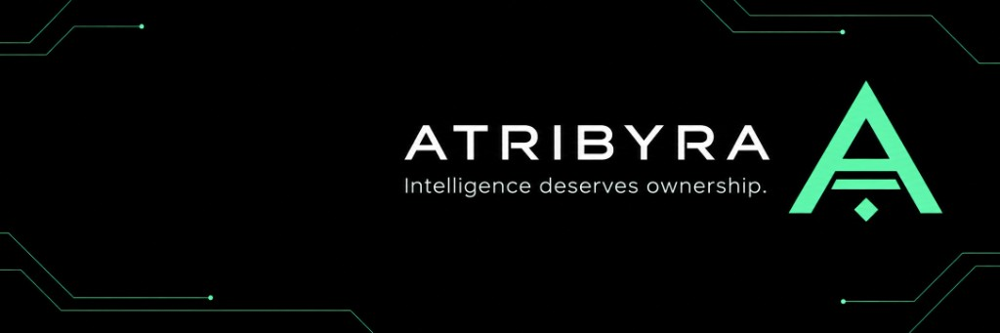

Turn data contributions into royalties.

  

  <a href="https://atribyra.xyz">atribyra.xyz</a>
  &nbsp;·&nbsp;
  <a href="https://explorer.atribyra.xyz">Explorer</a>
  &nbsp;·&nbsp;
  <a href="https://doc.atribyra.xyz">Docs</a>
  &nbsp;·&nbsp;
  <a href="https://blog.atribyra.xyz">Blog</a>
  &nbsp;·&nbsp;
  <a href="https://x.com/atribyraxyz">@atribyraxyz</a>

Atribyra makes the data that trains and tests AI an asset its contributors own. It keeps a durable record of where data started, who added value, which rights attach, and how royalties settle. Source bytes stay off-chain. $ALOD launches on Solana.

**Assetification.** Accepted work becomes a record with fixed, provable ownership.

**Availability.** Data is stored, packaged, delivered to licensed buyers, and closed at expiry.

**Treasury.** Each payment fixes what every owner earned, to claim whenever they choose.
