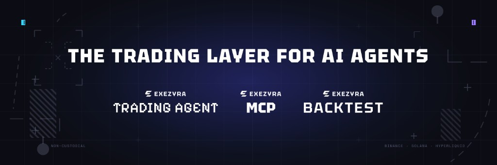

the trading layer for ai agents

  

  <a href="https://exezyra.xyz">exezyra.xyz</a>
  &nbsp;·&nbsp;
  <a href="https://x.com/exezyra">@exezyra</a>
  &nbsp;·&nbsp;
  <a href="mailto:admin@exezyra.xyz">admin@exezyra.xyz</a>

Agents turn a trading idea into a strategy, test it on market history, and run it on Binance, Solana, or Hyperliquid. Funds stay in the trader's own exchange account. Exezyra receives trading-only access.

The [MCP server](https://exezyra.xyz) exposes that same stack to Claude, Cursor, and any other Model Context Protocol client.
